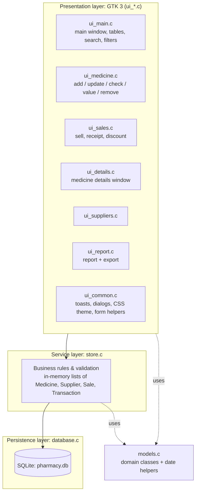
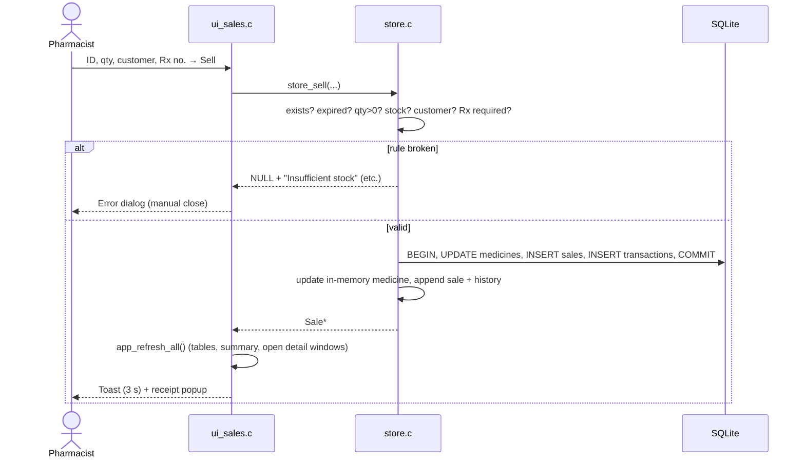
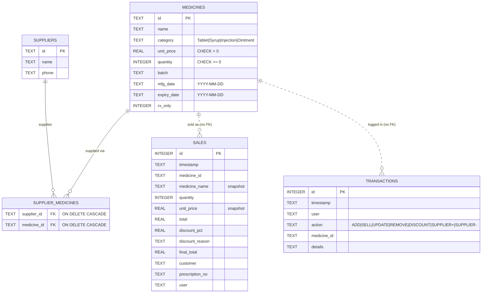
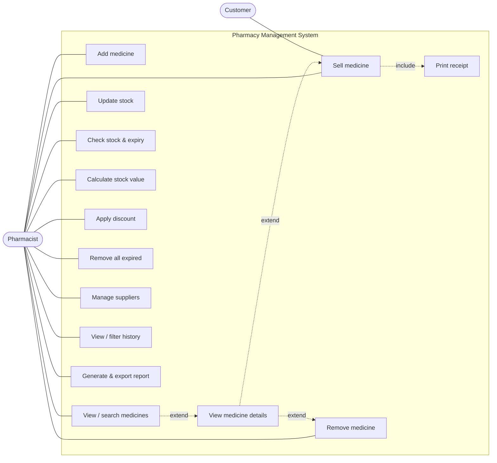

# Pharmacy Management System

A desktop pharmacy management application written in **C** with a **GTK 3** graphical interface and an **SQLite** database.

It covers the whole stock lifecycle of a small pharmacy:

- registering medicines
- restocking
- expiry tracking
- prescription-based selling
- discounts
- suppliers
- a full audit trail
- reports

All data is stored on disk and is still there the next time the program starts.

---

## Contents

1. [Features](#1-features)
2. [Quick start](#2-quick-start)
3. [Building a distributable Windows .exe](#3-building-a-distributable-windows-exe)
4. [Using the application](#4-using-the-application)
5. [Architecture](#5-architecture)
6. [Data model](#6-data-model)
7. [Design choices](#7-design-choices)
8. [Caveats and limitations](#8-caveats-and-limitations)
9. [Testing](#9-testing)
10. [Final report](#10-final-report)

---

## 1. Features

| # | Requirement | How it is delivered |
|---|-------------|---------------------|
| 1 | **Add Medicine** | Form with ID, name, category (Tablet/Syrup/Injection/Ointment), unit price, quantity, batch, manufacture and expiry dates, and a *prescription-only* flag. The app checks that the ID is unique, quantity > 0, price > 0, expiry > manufacture date, expiry > today, and that the manufacture date is not in the future. A success toast confirms the save. |
| 2 | **View Medicines** | Sortable, searchable table. Rows with quantity < 10 are **red**, rows expiring within 30 days are **orange**, and expired rows are **grey**. A *Status* column spells out every flag. |
| 3 | **Update Stock** | ID, quantity to add, new batch and new expiry date. The quantity must be > 0 and the expiry date cannot be in the past. The tables refresh straight away. |
| 4 | **Sell Medicine** | ID, quantity, customer and prescription number. A sale is refused with *"Expired medicine cannot be sold"*, *"Insufficient stock"* or *"Prescription required"* when those apply. A successful sale reduces the stock, records the sale and shows a receipt popup. |
| 5 | **Check Stock & Expiry** | Shows the stock level and expiry date in a dialog. A separate **low-stock** warning appears for stock below 10, and an **expiry** warning for medicines expiring within 30 days or already expired. |
| 6 | **Calculate Stock Value** | Modal popup with the value of non-expired stock and, separately, the value of expired stock (the loss). |
| 7 | **Apply Discount** | Select a sale in the *Sales* tab, then enter a percentage (5–15) and a reason (Senior citizen / Insurance / Bulk purchase). The discounted amount is shown in a dialog. A value outside 5–15 shows an error and leaves the sale unchanged. |
| 8 | **Remove Medicine / Suppliers** | Remove by ID behind a confirmation dialog. **Remove Expired (N)** on the medicines table removes every expired medicine in one click. Suppliers have an ID, name, phone and the medicines they supply, with Add and Remove. |
| 9 | **Transaction History** | Every add, sell, update, remove, discount and supplier change is logged with a timestamp and the signed-in user. It appears in a scrollable list that can be filtered by medicine ID and/or date (`YYYY-MM-DD`, or `YYYY-MM` for a month). |
| 10 | **Generate Report** | A report window showing: total medicines and quantity, stock value and expired loss, all-time sales total, number and amount of sales today, best-selling medicine, medicines below the re-order level, and medicines expiring within 30 days or already expired. **Export to text file…** saves it as `.txt`. |
| — | **Persistent storage** | SQLite database. It is created automatically on first run, so a missing file never crashes the program. |

**Extras requested on top of the brief:**

- **SQLite** is the database. Entities are modelled as structs with their own "methods", the C equivalent of classes (see [§7](#7-design-choices)).
- **Notification timing:**
  - Success messages are **toasts** that disappear after **3 seconds**.
  - **Error dialogs** stay until the user closes them.
  - **Confirmation dialogs** close themselves after **4 seconds**.
- The **medicines table is searchable** (ID, name, category, batch or status) and has a **View Details** button (double-clicking a row does the same). It opens a separate window with every field of the medicine, its suppliers, units sold and **all transactions for that medicine**. The window has **Sell** and **Remove** buttons.
- **Pharmacy green** (`#00843D`) is the primary colour for the header bar, primary buttons, toasts and the active tab.

---

## 2. Quick start

### Linux (Debian / Ubuntu)

```bash
sudo apt install build-essential pkg-config libgtk-3-dev libsqlite3-dev
make            # builds ./pharmacy
./pharmacy
make test       # optional: headless tests of the business rules
```

On Fedora, install `gcc make pkgconf gtk3-devel sqlite-devel` instead.

### Windows (MSYS2)

1. Install MSYS2 from <https://www.msys2.org>.
2. Open the **MSYS2 UCRT64** shell from the Start menu.
3. Install the toolchain and libraries:
   ```bash
   pacman -S --needed make mingw-w64-ucrt-x86_64-gcc mingw-w64-ucrt-x86_64-pkgconf \
                      mingw-w64-ucrt-x86_64-gtk3 mingw-w64-ucrt-x86_64-sqlite3
   ```
4. Build and run. Windows drives are mounted under `/c`, `/d`, and so on.
   ```bash
   cd /c/path/to/Arnaud
   make            # builds pharmacy.exe
   ./pharmacy.exe
   ```

### Where the data lives

| Platform | Database file |
|----------|---------------|
| Windows | `%LOCALAPPDATA%\PharmacyMS\pharmacy.db` |
| Linux | `~/.local/share/PharmacyMS/pharmacy.db` |

The current path is shown in the window's subtitle. Two optional environment variables change the defaults:

- `PHARMACY_DB=/path/to/file.db` uses a different database file (for example a shared or test database).
- `PHARMACY_USER="Jane"` skips the sign-in prompt (for a kiosk or scripted start).

To back up the system, copy the `.db` file. To reset it, delete the file.

---

## 3. Building a distributable Windows .exe

A GTK application cannot be a lone `.exe`. It needs the GTK DLLs, icons and settings next to it. The project automates this in two steps.

### Step 1: a portable folder (zip-and-go)

In the MSYS2 UCRT64 shell:

```bash
make dist
```

[tools/package-windows.sh](tools/package-windows.sh) creates `dist/PharmacyMS/` containing:

- `pharmacy.exe`, built with `-mwindows` so no console window opens
- every DLL it needs, found with `ldd`
- the gdk-pixbuf image loaders
- the Adwaita and hicolor icon themes
- the compiled GSettings schemas (the *Export* file dialog needs them)
- a `settings.ini` that sets the Windows UI font

Zip that folder and send it. It runs on any 64-bit Windows 10/11 machine without MSYS2.

### Step 2 (optional): a single installer, `PharmacyMS-Setup.exe`

1. Install [Inno Setup 6](https://jrsoftware.org/isinfo.php).
2. Open [tools/installer.iss](tools/installer.iss) and press **Compile**, or run `iscc tools\installer.iss`.
3. The result is `dist\PharmacyMS-Setup.exe`. It installs to Program Files and adds Start-menu and desktop shortcuts. The database is still stored per user in `%LOCALAPPDATA%`, so it does not need administrator write access.

---

## 4. Using the application

1. **Sign in.** Enter your name at start-up. It is stored with every operation in the history.
2. **Main window:**
   - a green header bar showing the signed-in user and the database path
   - a summary bar with live counts of low-stock, expiring and expired medicines and today's sales
   - an **Actions** sidebar
   - four tabs: **Medicines**, **Sales**, **Suppliers** and **Transaction History**
3. **Selected rows pre-fill dialogs.** Select a medicine in the table before choosing *Update Stock*, *Sell*, *Check Stock & Expiry* or *Remove*, and the dialog opens with that ID filled in.
4. **Input formats.** Dates are typed as `YYYY-MM-DD`. Prices use a dot as the decimal separator (`150.00`) on every locale.
5. **Form errors.** A form dialog stays open after a validation error so you can correct the input.

### Notification policy

| Kind | Widget | Behaviour |
|------|--------|-----------|
| Success (saved, sold, removed…) | Green toast at the bottom of the window | Disappears after **3 s** |
| Error (validation, insufficient stock…) | Modal error dialog | Stays until the user clicks **Close** |
| Confirmation (remove medicine, remove supplier) | Yes/No dialog with a visible countdown | Closes itself after **4 s**; no answer counts as **No** |
| Information the user must read (receipt, stock value, discount result, stock check, low-stock and expiry warnings) | Modal popup | Stays until closed |

---

## 5. Architecture

The code has three layers. Each layer only calls the layer below it.



| Module | Responsibility |
|--------|----------------|
| [src/models.h](src/models.h) / [models.c](src/models.c) | Domain "classes" `Medicine`, `Supplier`, `Sale` and `Transaction`, their methods (`medicine_is_expired`, `medicine_stock_value`, `sale_receipt_text`…) and strict date parsing. No GTK, no SQL. |
| [src/database.h](src/database.h) / [database.c](src/database.c) | The only module that contains SQL. It creates the schema and loads, inserts, updates and deletes rows using prepared statements. |
| [src/store.h](src/store.h) / [store.c](src/store.c) | Service layer. It holds the in-memory lists, enforces **every** business rule and writes each change, together with its history entry, inside one SQLite transaction. The in-memory state changes only after `COMMIT` succeeds. |
| [src/app.h](src/app.h) | The shared UI state (`App`) and the entry points of each UI module. |
| `src/ui_*.c` | GTK widgets only. They read fields, call a `store_*` function and show the result (toast, error or popup). |
| [src/main.c](src/main.c) | Opens the database, handles sign-in and shows the main window. |
| [tests/test_store.c](tests/test_store.c) | Headless tests of the service layer and persistence. |

### Request flow, using "Sell Medicine" as the example



---

## 6. Data model



Sales and transactions deliberately have **no foreign key** to `medicines`. They keep a snapshot of the name and price, so the sales history and audit trail survive when a medicine is removed.

---

## 7. Design choices

- **GTK 3.** It is a native C toolkit that runs on Linux and Windows from the same source and has ready-made table, dialog and file-chooser widgets. GTK 3 was chosen over GTK 4 because MSYS2 packages it well for Windows distribution, and `GtkDialog`/`gtk_dialog_run` keep the dialog code short.
- **"Classes" in C.** Each entity is a `struct` plus functions that take it as their first argument (`medicine_new`, `medicine_is_expired`, `medicine_free`…), with fixed-size string fields so objects are easy to copy. GObject would have been the heavier alternative and was judged over-engineering for this scope.
- **SQLite with write-through persistence.** The brief asks for data to be saved when the program closes. Instead, every change is committed **immediately** in a transaction. This meets the requirement ("no data is lost between runs") and is safer: a crash or power cut loses nothing. `sqlite3_open_v2(... CREATE)` plus `CREATE TABLE IF NOT EXISTS` means a missing file is never an error.
- **In-memory lists in front of the database.** At start-up all rows are loaded into `GPtrArray`s (the brief's "internal list" and "static list"). The UI reads from memory, which makes it fast and keeps SQL out of the UI. Memory is changed only after the database `COMMIT` succeeds, so the two can never disagree.
- **Validation lives in the service layer, not in the forms.** The UI only turns text into numbers. All rules (unique ID, ranges, dates, stock, prescription, discount range) are in `store.c`. They are therefore applied in exactly one place and can be tested without a GUI.
- **One history entry per change, in the same transaction.** The audit trail cannot miss an operation, and it never records one that failed.
- **Prescription-only flag.** The brief asks for a prescription number for "medicines marked as prescription-only" but lists no such field, so *Add Medicine* has a **Prescription-only** checkbox. The *Sell* dialog shows a live hint (stock, price, *PRESCRIPTION REQUIRED*, *EXPIRED*) as the ID is typed.
- **Colour priority.** A row can be both low-stock and expiring soon. Rows are coloured by the most urgent state: **expired (grey) > low stock (red) > expiring soon (orange)**. The *Status* column always lists every applicable flag, so no information is hidden.
- **Expiry semantics.** A medicine can be sold up to and including its expiry date; it counts as expired from the next day. "Expiring soon" means 0–30 days left.
- **Discounts never stack.** A discount is always calculated from the original amount, so applying 5% after 10% replaces the 10%. The history keeps both actions.
- **Interpretation of the notification rules.**
  - The brief's "confirmation dialog when the medicine is saved" is a **success toast** (3 s).
  - "Confirmation dialogs" are the Yes/No prompts before destructive actions. They close themselves after 4 s and treat no answer as **No**, so the timeout can never delete data.
  - The receipt, stock value, discount result and warnings stay open until the user closes them, because they must be read.
- **One-click "Remove Expired (N)".** The brief asks for expired medicines to be removable "in one click", so this button has no confirmation. Its label shows how many medicines it will remove, and every removal is recorded in the history.
- **Who performed the action.** There is a simple sign-in by name, without passwords. This satisfies "the user who performed it" without adding an account system the brief did not ask for.
- **Pharmacy green** `#00843D` is applied through a small CSS theme ([ui_common.c](src/ui_common.c)). Highlights use translucent tints instead of fixed colours, so the app stays readable with both light and dark desktop themes.

---

## 8. Caveats and limitations

- **One batch per medicine.** *Update Stock* adds quantity and **replaces** the batch number and expiry date, as the brief describes. Units from the old batch take the new expiry date. A real pharmacy would track stock per batch (FEFO). This is the most significant simplification.
- **No authentication.** The sign-in name is trusted. Anyone at the computer can type any name.
- **Single instance.** On Linux the app is single-instance: launching it again brings the open window forward. Two copies writing to the same database would not see each other's in-memory changes.
- **Currency** is shown as a plain number with 2 decimals and no currency symbol. Amounts use `double`. That is fine at pharmacy scale, but a production system would use integer minor units.
- **Date entry** uses typed `YYYY-MM-DD` text fields, as the brief specifies, rather than a calendar picker.
- **"Today" comes from the computer's clock.** A wrong system date changes which medicines count as expired.
- **No undo** for removals. The deleted record's key details remain in the transaction history.
- **The report export** is plain text, not PDF or CSV.
- **The Windows build** is a folder or installer of several tens of MB because it bundles GTK. It is not a single static `.exe`.

---

## 9. Testing

`make test` builds and runs [tests/test_store.c](tests/test_store.c). It exercises the service and persistence layers without a display, on a fresh temporary database:

- **Add Medicine:** a duplicate ID, quantity 0, price 0, expiry today, expiry before manufacture and an impossible date (`2026-02-30`) are all rejected.
- **Selling:** insufficient stock, missing prescription, quantity 0, missing customer and expired medicine are all rejected. A valid sale computes the correct total and stock.
- **Discounts:** 20% and 4.9% are rejected and leave the sale unchanged. An invalid reason is rejected. 10% and then 5% gives the correct replacement amount.
- **Update Stock:** quantity 0 and a past expiry are rejected. A valid update changes the quantity, batch and expiry.
- **Suppliers:** an invalid phone number is rejected. Removing a medicine also removes its supplier links.
- **Totals:** stock value, expired loss, today's sales count and the best seller are correct.
- **Persistence:** after close and re-open, every medicine, sale, discount, supplier and history entry is restored.
- **Missing file:** a missing database file is created rather than crashing the program.

The suite also runs clean under AddressSanitizer and UndefinedBehaviorSanitizer, with no leaks or memory errors. The GUI was run on Ubuntu 24.04 with GTK 3.24 in a dark desktop theme and checked from screenshots of the main window, colour coding and details window. The Windows packaging script has not yet been run on a Windows machine.

---

## 10. Final report

### 10.1 Summary

The system meets all ten functional requirements of the brief. It adds SQLite persistence, the notification timing rules, a searchable medicine table with a per-medicine details window, and a pharmacy-green theme.

The codebase is about 3,000 lines of C in three layers: GTK UI, service, and SQLite repository. All business rules are in one testable module.

### 10.2 Actors

| Actor | Description |
|-------|-------------|
| **Pharmacist** (primary) | Signs in by name and performs every operation: stock, sales, suppliers and reports. |
| **Customer** (secondary) | Named on sales and receipts, and supplies a prescription number when one is needed. |
| **Supplier** (secondary) | Recorded as a contact and linked to the medicines it supplies. |

### 10.3 Use case diagram



### 10.4 Key use cases

**UC5: Sell medicine**

| | |
|---|---|
| **Actor** | Pharmacist (with a customer) |
| **Precondition** | The medicine exists. |
| **Main flow** | 1. The pharmacist opens *Sell Medicine* from the sidebar or the details window. 2. They enter the ID, quantity and customer name, plus the prescription number if the medicine needs one. 3. The system checks that the medicine is not expired, the quantity is > 0, the stock is enough, the customer is given and the prescription is present if required. 4. The system reduces the stock, records the sale and its history entry in one transaction, shows a 3-second success toast and opens the receipt. |
| **Alternative flows** | 3a. The medicine is expired: error *"Expired medicine cannot be sold"*. 3b. The stock is too low: error *"Insufficient stock: only N unit(s)…"*. 3c. The medicine is prescription-only and no number was given: error *"Prescription required"*. In every case the dialog stays open for correction and nothing is changed. |
| **Postcondition** | The stock is reduced, the sale appears in the *Sales* tab, the history and any open details window, and the summary bar is updated. |

**UC1: Add medicine**

| | |
|---|---|
| **Main flow** | The pharmacist fills in the form and clicks *Save*. The system validates the input, stores the medicine, logs `ADD`, shows a toast and refreshes the table. |
| **Alternative flows** | A duplicate ID, quantity or price ≤ 0, an invalid date, expiry ≤ manufacture date, or expiry ≤ today shows an error dialog and keeps the form open. |

**UC9: Apply discount**

| | |
|---|---|
| **Main flow** | The pharmacist selects a sale, chooses *Apply Discount*, and enters a percentage (5–15) and a reason. The system calculates the final amount from the original total, saves it, logs `DISCOUNT` and shows the discounted amount in a dialog. |
| **Alternative flows** | A percentage outside 5–15 or not a number shows an error, and the sale is left unchanged. |

**UC10 and UC11: Remove medicine / Remove all expired**

| | |
|---|---|
| **Main flow (UC10)** | The pharmacist enters an ID, or clicks *Remove* in the details window, and confirms within 4 seconds. The system deletes the medicine and its supplier links, logs `REMOVE` and refreshes all views. Any open details window for that medicine closes. |
| **Alternative flow** | No answer within 4 seconds counts as *No*, and nothing is deleted. |
| **UC11** | One click on *Remove Expired (N)* removes all N expired medicines and logs each removal. |

**UC14: Generate and export report**

| | |
|---|---|
| **Main flow** | The pharmacist clicks *Generate Report*. A window shows the stock, sales, best-seller, re-order, expiring and expired sections. *Export to text file…* saves it, by default as `pharmacy-report-YYYY-MM-DD.txt`. |

### 10.5 How the requirements were verified

| Requirement area | Verified by |
|------------------|-------------|
| Validation rules (add, update, sell, discount, supplier) | Automated tests and manual GUI checks |
| Colour coding, search, details window, toasts and timed dialogs | Manual GUI checks (dark theme) |
| Persistence and missing-file start-up | Automated tests (fresh file, then close and re-open) |
| Memory safety | AddressSanitizer and UBSan run of the test suite |

### 10.6 Possible future work

- Track stock per batch, with first-expiry-first-out (FEFO) selling.
- Add user accounts with passwords and roles (pharmacist / cashier / admin).
- Add a calendar date picker, barcode scanning and printer output for receipts.
- Export reports as CSV or PDF, add sales charts, and generate re-order lists per supplier.
- Add a currency setting, and store amounts in integer minor units.

---

## Project structure

```
Arnaud/
├── Makefile                  build / run / test / dist targets
├── README.md
├── src/
│   ├── main.c                start-up, sign-in
│   ├── app.h                 shared UI state + module entry points
│   ├── models.h / models.c   domain classes + date helpers
│   ├── database.h / .c       SQLite repository (only place with SQL)
│   ├── store.h / store.c     business rules, in-memory lists, reports
│   ├── ui_common.c           theme, toasts, dialogs, form helpers
│   ├── ui_main.c             main window, tables, search, history filter
│   ├── ui_medicine.c         add / update / check / value / remove
│   ├── ui_sales.c            sell, receipt, discount
│   ├── ui_details.c          medicine details window
│   ├── ui_suppliers.c        supplier add / remove
│   └── ui_report.c           report window + export
├── tests/
│   └── test_store.c          headless tests (make test)
└── tools/
    ├── package-windows.sh    make dist → portable Windows folder
    └── installer.iss         Inno Setup → PharmacyMS-Setup.exe
```
